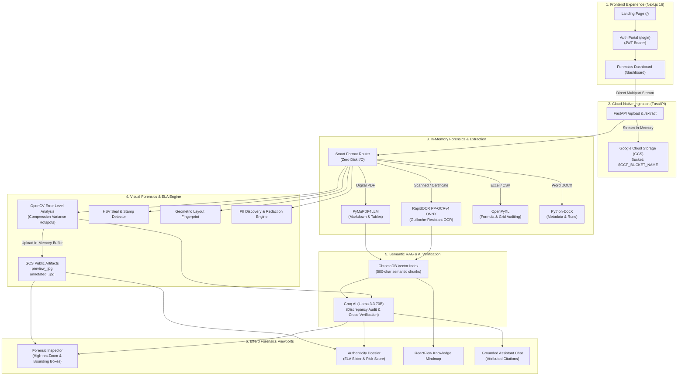

# officedocuments Enterprise — AI Document Forensics & Tamper Intelligence

> 🌐 **Live Deployed Application**: [https://officedocuments.vercel.app](https://officedocuments.vercel.app)  
> 🚀 **Live Cloud Run Backend API**: [https://docverify-backend-1024880164701.asia-south1.run.app](https://docverify-backend-1024880164701.asia-south1.run.app)

[](https://fastapi.tiangolo.com)
[](https://nextjs.org)
[](https://cloud.google.com/storage)
[](https://github.com/RapidAI/RapidOCR)
[](https://pymupdf.readthedocs.io)
[](https://groq.com)
[](https://tailwindcss.com)

**officedocuments Enterprise** is an autonomous, cloud-native document forensics and verification platform engineered to detect digital tampering, verify credentials, and extract structural data across academic marks cards, identity documents, legal certificates, spreadsheets, and enterprise PDFs.

Now wired with **Google Cloud Storage (GCS)** for fully stateless, containerized **Google Cloud Run** deployment.

---

## How officedocuments Works (End-to-End Workflow)



---

## Complete Step-by-Step Architecture

### Step 1: Authentication & Access Control
* **Landing Page (`/`)**: Product showcase highlighting document forensic capabilities, court admissibility standards, and architectural breakdown.
* **Authentication Portal (`/login`)**: Secure authentication supporting user registration (`POST /register`) and JWT token generation (`POST /token`) with bcrypt password hashing.
* **Direct Platform Access**: Instant access to forensics workspace without mandatory login barrier, with pre-configured evaluator session (`admin@officedocuments.com`).
* **Client-Side Route Guard**: All dashboard views (`/dashboard`, `/workspace`) verify active JWT bearer tokens, redirecting unauthenticated requests.

### Step 2: Cloud Ingestion (Google Cloud Storage Streaming)
* **Zero Local Disk Writes**: When a document is uploaded, FastAPI directly streams the file into the Google Cloud Storage bucket defined by `GCP_BUCKET_NAME` using `blob.upload_from_file()`.
* **Cloud Run Ready**: Container filesystem remains 100% ephemeral and stateless, enabling horizontal auto-scaling with zero persistent volume requirements.
* **Service Account Authentication**: Authenticates via `GOOGLE_APPLICATION_CREDENTIALS_JSON` environment variable using `service_account.Credentials.from_service_account_info()` or native Cloud Run Application Default Credentials (ADC).

### Step 3: Fast-Path Multi-Format Parsing
* **Digital PDFs**: Evaluates text density in milliseconds. Clean digital pages are extracted directly via `PyMuPDF4LLM` into structured Markdown and bounding boxes without invoking heavy OCR models.
* **Certificates & Scans**: Routes watermarked or scanned pages to `RapidOCR PP-OCRv4 ONNX`. Operates reliably over complex guilloche security patterns and colored bank seals without freezing.
* **Spreadsheets (`.xlsx`, `.csv`)**: Analyzes all workbook sheets in memory via `OpenPyXL`. Scans formulas for injection vectors (`=cmd`, `=SYSTEM`, malicious external links) and tabulates row/column metrics.
* **Word Documents (`.docx`)**: Extracts paragraph runs, embedded table hierarchies, and author revisions via `python-docx`.

### Step 4: OpenCV Visual Forensics & Cloud Artifacts
* **Error Level Analysis (ELA)**: Recompresses image buffers at controlled JPEG quality levels to isolate variance in compression error. Detects copy-paste splices, inserted text numbers, and altered signatures.
* **Cloud Artifact Generation**:
  * Clean preview: `https://storage.googleapis.com/{GCP_BUCKET_NAME}/preview_<doc_id>.jpg`
  * ELA overlay: `https://storage.googleapis.com/{GCP_BUCKET_NAME}/annotated_<doc_id>.jpg`
  * Both are encoded in-memory via OpenCV JPEG buffers and uploaded directly to GCS.
* **Layout Fingerprinting**: Computes normalized geometric coordinates of all headings and bodies to generate a spatial fingerprint that verifies template conformity against known institutional layouts.
* **PII Redaction**: Discovers sensitive identifiers (Aadhaar, PAN, SSN, bank accounts) and redacts them in the RAG pipeline for audit compliance.

### Step 5: Grounded Vector RAG & Cross-Document Verification
* **ChromaDB Vector Store**: Chunks document text into 500-character semantic blocks with page-level metadata.
* **Groq Llama-3.3 70B**: Analyzes extracted content against ELA visual findings to produce composite authenticity scores. Cross-verifies multi-document cases (e.g. comparing an applicant's degree certificate against an official transcript).
* **Conversational Assistant**: Allows investigators to query documents in plain English with citation attribution back to exact chunk sources.

---

## Core Capabilities Matrix

| Capability | Engine / Technology | Cloud-Native Behavior |
| :--- | :--- | :--- |
| **Cloud Storage Vault** | Google Cloud Storage (GCS) | Streams uploaded documents and forensic image overlays directly to cloud bucket. |
| **Authentication** | OAuth2 + JWT (HS256) + Bcrypt | Encrypted session tokens with 24h expiration and role-based access control. |
| **OCR Processing** | RapidOCR (PaddleOCR PP-OCRv4 ONNX) | Guilloche-resistant text extraction with bounding box coordinates. |
| **PDF Extraction** | PyMuPDF4LLM (`fitz`) | Millisecond markdown and table conversion from in-memory byte streams. |
| **Tamper Detection** | OpenCV Error Level Analysis (ELA) | Detects digital recompression artifacts; uploads public `.jpg` overlays to GCS. |
| **Official Seal Detection** | OpenCV HSV Contour Isolation | Identifies official colored ink stamps, circularity ratios, and seals. |
| **Spreadsheet Forensics** | OpenPyXL + In-memory Streams | Multi-sheet data grid extraction and malicious formula detection. |
| **RAG Intelligence** | ChromaDB + Groq Llama-3.3 70B | Grounded conversational QA with chunk-level distance attribution. |

---

## User Interface & Views (`/dashboard`)

The frontend follows the **Efferd Dashboard-3** visual language with full Light and Dark theme toggling:

1. **Uploads & Metadata (`Uploads & Metadata`)**:
   * Drag-and-drop file ingestion (PDF, PNG, JPG, XLSX, DOCX, TXT, CSV, JSON).
   * Format-specific viewport (PDF page viewer, spreadsheet sheet browser, DOCX hierarchy, high-res image zoom).
   * PII entity breakdown table with confidence percentages.
2. **Analysis Report (`Analysis Report`)**:
   * Radial Authenticity Gauge displaying composite integrity score (0% to 100%).
   * OpenCV ELA comparator with interactive toggle between original scan and cloud-hosted ELA heatmap.
   * Executive auditor summary and discrepancy checklist.
   * Export Dossier button generating an audit-ready JSON report.
3. **Document Map (`Document Map`)**:
   * Interactive ReactFlow mindmap displaying radial entity graphs, document sections, and metadata links.
   * Hierarchical tree view for structured inspection.
4. **Forensic Assistant (`Assistant`)**:
   * Conversational chatbot grounded strictly in ChromaDB vector chunks.
   * Source attribution drawer displaying verbatim document excerpts.
5. **System Diagnostics (`System Diagnostics`)**:
   * Real-time latency and connectivity monitors for FastAPI, Google Cloud Storage, ChromaDB, and Groq LLM.

---

## Environment Configuration

Create a `.env` file in the root directory (refer to `.env.example`):

```bash
# MongoDB Database (Atlas or local)
MONGO_URI="mongodb+srv://<username>:<password>@cluster.mongodb.net/"

# LLM & Embedding API Keys
GROQ_API_KEY="gsk_your_groq_api_key_here"
HF_TOKEN="hf_your_huggingface_token_here"

# Google Cloud Storage (GCS)
GCP_BUCKET_NAME="docverify-forensics-vault"

# Service Account Credentials (JSON string for Cloud Run or local dev)
GOOGLE_APPLICATION_CREDENTIALS_JSON='{"type":"service_account","project_id":"your-project-id","private_key":"...","client_email":"..."}'

# JWT Secret Key
JWT_SECRET_KEY="docverify-enterprise-forensics-secret-key-nist-compliant"
```

---

## Quick Start & Local Execution

### Prerequisites
* Python 3.10+
* Node.js 18+ & npm

### 1. Backend Setup (FastAPI)
```bash
# Activate virtual environment
.\.venv\Scripts\activate   # Windows
source .venv/bin/activate  # Linux / macOS

# Install dependencies
pip install -r requirements.txt

# Start backend server
python -m uvicorn main:app --host 127.0.0.1 --port 8000 --reload
```
Interactive OpenAPI documentation: `http://127.0.0.1:8000/docs`.

### 2. Frontend Setup (Next.js)
```bash
cd frontend
npm install
npm run dev
```
Open `http://localhost:3000` in your browser.

### 3. One-Click Evaluator Login
* **Email:** `admin@docverify.com`
* **Password:** `password123`
* Click **"Auto-fill Credentials"** on the `/login` page to enter directly.

---

## Cloud Deployment (Google Cloud Run)

Because **officedocuments** uses **in-memory streaming** with **Google Cloud Storage**, it deploys seamlessly to Cloud Run as a stateless container:

```bash
# 1. Build & submit Docker image
gcloud builds submit --tag gcr.io/<PROJECT_ID>/officedocuments-api

# 2. Deploy to Cloud Run
gcloud run deploy officedocuments-api \
  --image gcr.io/<PROJECT_ID>/officedocuments-api \
  --platform managed \
  --region us-central1 \
  --allow-unauthenticated \
  --set-env-vars GCP_BUCKET_NAME="officedocuments-forensics-vault",GROQ_API_KEY="..."
```

---

## Enterprise Forensic Standards
* **SHA-256 Hashing**: Every document receives an immutable cryptographic hash upon streaming.
* **Non-Destructive Inspection**: Original files remain unaltered in GCS; visual overlays and ELA heatmaps are saved as separate forensic artifacts.
* **Privacy Compliance**: Discovered PII is isolated and marked for regulatory compliance (GDPR, HIPAA, DPDP).
