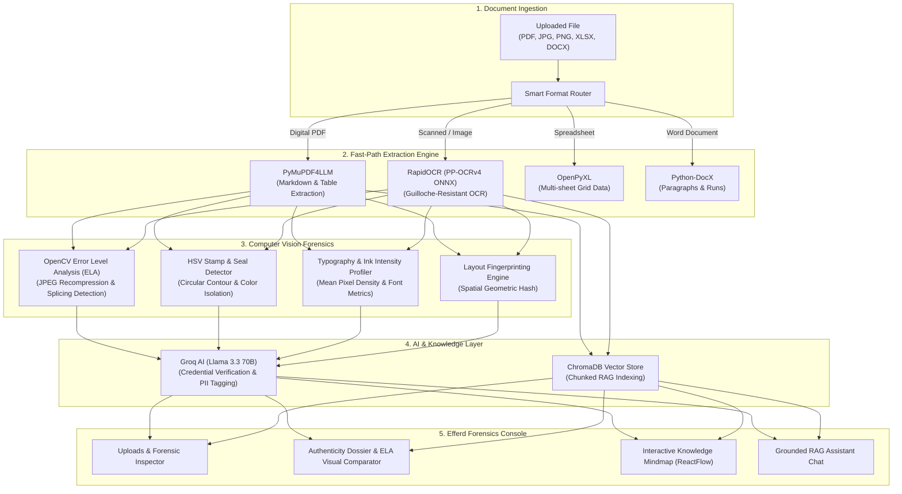

# DocVerify Enterprise — AI Document Forensics & Tamper Intelligence

[](https://fastapi.tiangolo.com)
[](https://nextjs.org)
[](https://github.com/RapidAI/RapidOCR)
[](https://pymupdf.readthedocs.io)
[](https://groq.com)
[](https://tailwindcss.com)

**DocVerify Enterprise** is an autonomous forensic intelligence platform engineered to detect digital tampering, verify credentials, and extract structural data across academic marks cards, identity documents, legal certificates, spreadsheets, and enterprise PDFs.

---

## What is DocVerify Enterprise?

Modern image editing software, PDF modifier tools, and generative AI make altering academic grades, tax forms, registration numbers, and official signatures trivial. Manual document verification across thousands of files creates bottlenecks for universities, HR teams, banks, and legal auditors.

DocVerify automates document verification by combining:
1. **Computer Vision Forensics (OpenCV)** to catch invisible pixel-level tampering and compression artifacts.
2. **Guilloche-Resistant OCR (RapidOCR PP-OCRv4 ONNX)** to extract text across complex watermark backgrounds without freezing.
3. **Multi-Format Parsing (PDF, Excel, Word, Images)** with format-specific forensic viewports.
4. **Vector RAG & AI Verification (ChromaDB + Groq Llama-3.3)** to validate mathematical totals, cross-verify data, and answer investigator questions.

---

## System Architecture & Workflow



---

## How to Use DocVerify

The user interface features a dedicated **Product Landing Page** (`/`), a secure **Authentication Portal** (`/login`), and an **Efferd Dashboard-3** forensics console (`/dashboard`) with full Light and Dark theme support.

### Test Credentials (One-Click Access)
For evaluators, hackathon judges, and test users:
* **Email:** `admin@docverify.com`
* **Password:** `password123`
* *(A convenient "Auto-fill Credentials" button is provided directly on the `/login` screen).*

### 1. Upload & Inspect (`Uploads & Metadata`)
* **Drag-and-Drop Ingestion:** Drop single or batches of files (`.pdf`, `.png`, `.jpg`, `.jpeg`, `.xlsx`, `.docx`, `.txt`, `.csv`, `.json`).
* **Format-Specific Forensic Inspector:**
  * **PDFs:** View pages with highlighted text bounding boxes, font heights, and structural metadata.
  * **Images:** Zoom and pan high-resolution certificate scans.
  * **Excel Spreadsheets:** Switch between workbook sheets to inspect cell matrices, row/column dimensions, and formula counts.
  * **Word Documents:** Review paragraph hierarchies and table matrices.
* **Sensitive PII Discovery:** Automatically identifies and tags sensitive entities (Aadhaar, PAN, SSN, Phone, Email, Bank Accounts) with confidence levels.

### 2. Forensic Authenticity Audit (`Analysis Report`)
* **Radial Authenticity Gauge:** View an instant composite integrity score (0% to 100%) calculated across visual, metadata, and structural forensic layers.
* **OpenCV ELA Visual Comparator:** Toggle between the clean original scan and the Error Level Analysis (ELA) overlay to inspect digital alteration hotspots and compression variance.
* **Discrepancy Breakdown:** Review itemized findings including font size irregularities, mismatched dates, modified EXIF creation software, and altered totals.
* **Dossier Export:** Click **Export Dossier** to download a cryptographically structured JSON audit package.

### 3. Knowledge Graph Exploration (`Document Map`)
* **Hierarchical Tree View:** Explore documents, categories, metadata nodes, and extracted entities in an interactive tree view.
* **ReactFlow Mindmap:** Switch to the radial node canvas to visualize connections between document sections, headings, stamps, and credential entities with real-time zooming and node selection.

### 4. Grounded Forensic Assistant (`Assistant`)
* **Vector Semantic Search:** Ask free-form investigative questions grounded strictly in the target document’s indexed chunks.
* **Source Attribution:** Expand referenced ChromaDB chunks to inspect the exact textual evidence and cosine match distances behind every answer.
* **Investigator Starter Queries:** One-click prompt cards to instantly audit credential consistency, verify calculation accuracy, or summarize anomalies.

### 5. Auditor Profile & Audit Session Management
* **Auditor Credentials:** Configure investigator name and professional role via the Account Menu.
* **Diagnostic Console:** Open the live system diagnostics drawer to view OCR engine readiness, ChromaDB collection status, and storage connectivity.
* **Session Export:** Download complete session activity logs including timestamps, verified files, and auditor signatures.

---

## Core Capabilities

| Capability | Engine | Purpose |
| :--- | :--- | :--- |
| **OCR Processing** | RapidOCR (PaddleOCR PP-OCRv4 ONNX) | Extracts text from certificates, guilloche watermarks, and scanned IDs without freezing. |
| **PDF Extraction** | PyMuPDF4LLM (`fitz`) | Generates clean Markdown and structured tables for digital PDFs in milliseconds. |
| **Tamper Detection** | OpenCV Error Level Analysis (ELA) | Detects digital modifications, copy-paste alterations, and JPEG recompression artifacts. |
| **Official Seal Detection** | OpenCV HSV Contour Analysis | Identifies official colored ink stamps, circularity ratios, and institutional seals. |
| **Layout Fingerprinting** | Spatial Geometric Hashing | Computes layout anchor positions to verify conformity against known institutional templates. |
| **PII Tagging** | Regex & Entity Engine | Detects and tags sensitive identity numbers, bank details, and contact information. |
| **RAG Intelligence** | ChromaDB + Groq Llama-3.3 | Provides grounded conversational analysis with chunk-level attribution. |
| **Office File Support** | OpenPyXL + Python-DocX | Natively extracts multi-sheet Excel data grids and Word document structures. |

---

## User Interface Themes

DocVerify Enterprise features a theme engine with instant mode toggling:
* **Light Mode (Default):** Crisp white cards, warm-gray canvas (`#fafafa`), hairline borders (`#e4e4e7`), and dark slate typography.
* **Dark Mode:** Deep zinc canvas (`#09090b`), elevated panels (`#18181b`), and high-contrast text designed for low-light forensics labs.

---

## Quick Start & Installation

### Prerequisites
* Python 3.10+
* Node.js 18+ & npm

### 1. Backend Setup (FastAPI)
```bash
# Activate virtual environment
.\.venv\Scripts\activate

# Install dependencies
pip install -r requirements.txt

# Run the FastAPI server
python -m uvicorn main:app --host 127.0.0.1 --port 8000 --reload
```
The API documentation is available at `http://127.0.0.1:8000/docs`.

### 2. Frontend Setup (Next.js)
```bash
cd frontend
npm install
npm run dev
```
Open `http://localhost:3000` in your browser.

---

## Enterprise Audit Standards
* **Cryptographic Hashing:** Every ingested document receives an immutable SHA-256 integrity hash.
* **Non-Destructive Forensics:** Original evidence files are preserved in read-only format; all visual forensic layers (ELA, bounding boxes) are rendered non-destructively.
* **Privacy-Compliant:** Sensitive credential findings (PII) are isolated and tagged for regulatory compliance.
